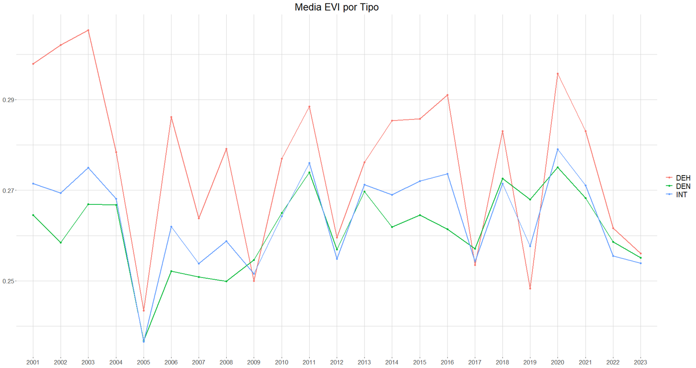
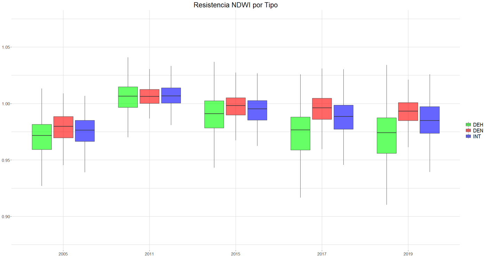

# Drought vulnerability of holm oak forests in Andalusia from satellite data

Code from my Bachelor's thesis in Biology, *Análisis de la vulnerabilidad de los bosques de Quercus andaluces frente al cambio climático* (University of Córdoba, 2024, grade 8.6/10).

The project uses **23 years of MODIS satellite data (2001–2023)** to monitor **1,251 holm oak (*Quercus ilex* subsp. *rotundifolia*) plots** from the Spanish National Forest Inventory, measures their **resistance and recovery to five extreme droughts**, and uses **Generalized Additive Models (GAMs)** to identify the climatic and topographic factors behind those responses.

## Key findings

- **Forest density drives the response to drought.** Open woodlands (*dehesas*) are the most affected by droughts but also recover more strongly; dense forests are more stable but recover more slowly — a **resistance–recovery trade-off**.
- In the most severe droughts (2005, 2017, 2019), resistance increased with density: **dense > intermediate > dehesa**.
- Forests in the **north-west** of Andalusia were more resilient than those further south.
- In the GAMs, **actual/potential evapotranspiration and elevation** were the most significant predictors; slope and soil moisture also mattered for recovery. Models explained up to **56 % of the deviance** (NDWI resistance, dense forests).

<p align="center">
  
  
</p>
<p align="center"><em>Left: mean NDVI per year by forest type (DEH = dehesa, INT = intermediate, DEN = dense). Right: NDWI resistance for each drought event.</em></p>

## Methods

**Study plots.** 1,251 pure holm oak plots of the Spanish National Forest Inventory in Andalusia, classified by tree density into dehesa (DEH, 20–50 trees/ha), intermediate (INT, 50–350) and dense (DEN, ≥ 400).

**Spectral indices.** Annual median NDVI and EVI (MODIS MOD13A1, scale factor 0.0001) and NDWI (MODIS MCD43A4) per plot, extracted in Google Earth Engine.

**Drought events.** 2005, 2011, 2015, 2017 and 2019, selected from annual precipitation records. For each event and index, values were rescaled to [0, 1] and two resilience indicators were computed (Lloret et al., 2011):

- **Resistance** = index in the drought year / index in the previous year
- **Recovery** = index in each following year / index in the drought year (until the next event)

**Statistical models.** For the 2005 drought (the most severe), GAMs with Gaussian errors and cubic regression splines relate resistance (2005) and first-year recovery (2006) to climate (actual and potential evapotranspiration, soil moisture, solar radiation), topography (slope, aspect, elevation, hillshade) and tree density — one model per index × indicator × forest type (18 models), compared by adjusted R², deviance explained and AIC.

## Code

| Step | Script | Language |
|---|---|---|
| Satellite data extraction | `gee/extract_spectral_indices.js` | Google Earth Engine (JavaScript) |
| Shared setup (packages, paths, data loading, plot style) | `R/00_setup.R` | R |
| Time series of indices, resistance and recovery | `R/01_time_series_plots.R` | R (ggplot2) |
| GAMs, model summaries and diagnostics | `R/02_gam_models.R` | R (mgcv) |

### How to run

**Google Earth Engine:** open `gee/extract_spectral_indices.js` in the [Code Editor](https://code.earthengine.google.com/), set the path of your plots asset and run the export task.

**R** (from the repository root):

```r
install.packages(c("dplyr", "tidyr", "purrr", "ggplot2", "mgcv", "corrplot"))
```

```bash
Rscript R/01_time_series_plots.R   # -> figures/
Rscript R/02_gam_models.R          # -> results/ (model summary, term significance, diagnostics)
```

The plot dataset is not public; see [data/README.md](data/README.md) for the expected input format.

## Repository structure

```
.
├── gee/
│   └── extract_spectral_indices.js
├── R/
│   ├── 00_setup.R
│   ├── 01_time_series_plots.R
│   └── 02_gam_models.R
├── data/
│   └── README.md        # expected input files (data not included)
└── docs/img/            # figures from the thesis
```

## Tools

Google Earth Engine (JavaScript API) · R · mgcv · dplyr / tidyr / purrr · ggplot2 · corrplot

## Author

Juan Benítez Humanes
